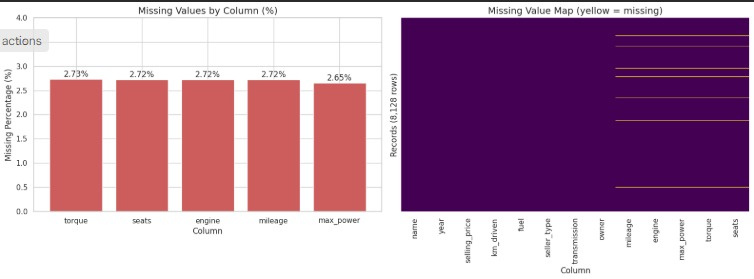
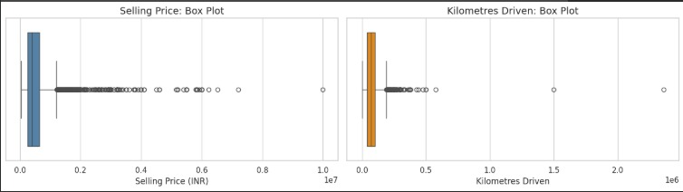
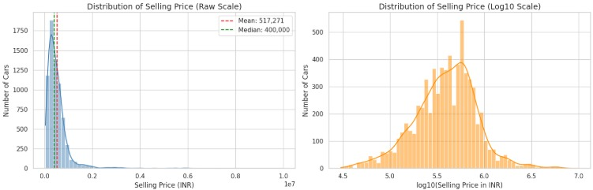
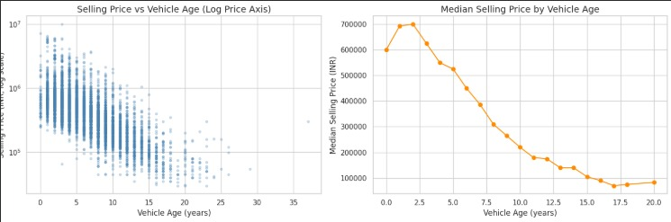
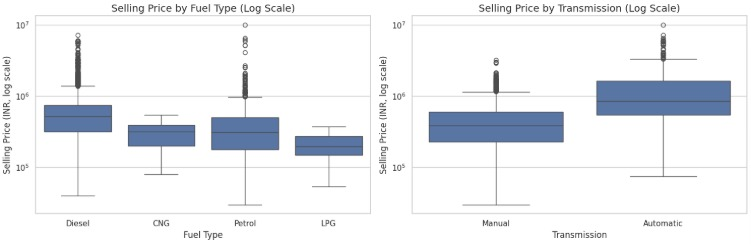
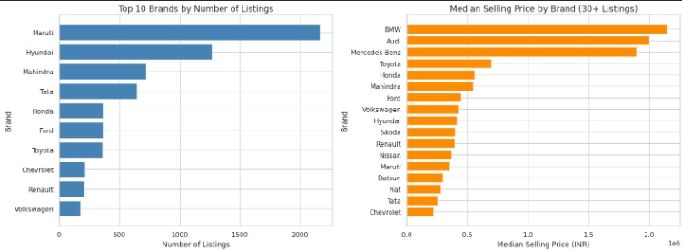
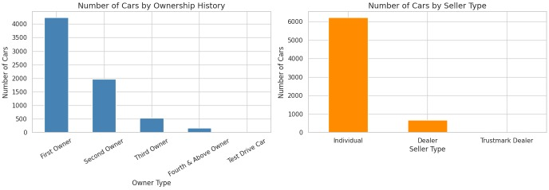

# 🚗 Exploratory Data Analysis: Used Car Prices

## 📋 Project Details

This project explores used car listings in India using the CarDekho dataset. The aim is to understand the factors associated with used-car selling prices, examine data quality, and identify patterns related to vehicle age, fuel type, transmission, engine specifications, ownership and brand.

The analysis was performed in **Google Colab** using Python, Pandas, NumPy, Matplotlib and Seaborn. It includes data inspection, missing-value analysis, duplicate handling, data cleaning, feature engineering, outlier investigation, summary statistics and visualisation.

---

## 📊 Dataset

**Dataset:** CarDekho Used Car Data (Car Details v3)  
**Source:** [CarDekho Used Car Dataset – Kaggle](https://www.kaggle.com/datasets/nehalbirla/vehicle-dataset-from-cardekho)

The dataset contains listings for used cars in India, including vehicle specifications, selling prices and ownership details.

### Dataset Details
- Original records: **8,128**
- Original columns: **13**
- Data types: Numerical and categorical.

### Important Columns
- `name` – Car name and model.
- `year` – Manufacturing year.
- `selling_price` – Selling price in INR.
- `km_driven` – Distance driven in kilometres.
- `fuel` – Fuel type.
- `seller_type` – Individual, dealer or trustmark dealer.
- `transmission` – Manual or automatic.
- `owner` – Previous ownership category.
- `mileage` – Mileage with its unit.
- `engine` – Engine capacity.
- `max_power` – Maximum engine power.
- `torque` – Engine torque.
- `seats` – Number of seats.

---

## ⚙️ Data Preprocessing

The following preprocessing steps were performed:

1. **Dataset Inspection:** Checked shape, sample rows, column types, memory usage and unique values.
2. **Missing Values:** Found missing values in `torque` (222), `seats` (221), `engine` (221), `mileage` (221) and `max_power` (215).
3. **Missing-Value Handling:** Retained missing specification values instead of applying unnecessary imputation.
4. **Duplicate Removal:** Removed **1,202 exact duplicate rows**, reducing the dataset from 8,128 to 6,926 records.
5. **Numeric Conversion:** Extracted numeric portions from `mileage`, `engine` and `max_power`.
6. **Invalid Values:** Set invalid zero mileage and unusable maximum-power values to missing.
7. **Mileage Units:** Separated `kmpl` and `km/kg` values to maintain consistency.
8. **Feature Engineering:** Created `age` using `2020 - year` and extracted the manufacturer as `brand`.
9. **Outlier Handling:** Investigated unusual kilometre-driven values and created a separate `km_driven_clean` column.

After cleaning, the dataset contained **6,926 rows and 19 columns**.

---

## 🔍 Missing Value Analysis

Two visualisations were used to understand the distribution of missing values.

### 1. Missing Values Analysis

The analysis identified missing values mainly in the technical specification columns. A total of 222 records contained at least one missing specification value.

### 2. Missing Values Heatmap

The heatmap shows that missing values frequently occur together. In particular, 215 records were missing all five technical specification fields.

---

## 📈 Exploratory Data Analysis

### 1. Outlier Analysis

The IQR method identified 328 high-price records (4.74%) and 167 high-kilometre records (2.41%).

Genuine expensive car listings were retained, while three implausible kilometre values were handled separately.

### 2. Selling Price Distribution

The mean selling price was approximately **INR 517,271**, while the median was **INR 400,000**.

The original distribution was strongly right-skewed. Applying a log10 transformation reduced the skewness from 5.57 to approximately -0.16.

### 3. Vehicle Age vs Selling Price

Vehicle age showed a strong negative correlation with log selling price (**r = -0.72**).

In general, older cars had lower selling prices.

### 4. Price by Fuel Type and Transmission

Diesel cars had a median selling price of INR 520,000 compared with INR 310,000 for petrol cars.

Automatic cars had a median selling price of INR 850,000 compared with INR 385,000 for manual cars.

### 5. Correlation Analysis

The correlation heatmap highlights relationships between selling price and numerical features.

Important observations:
- Age: -0.72
- Maximum power: +0.65
- Engine capacity: +0.47
- Mileage: +0.02

### 6. Brand-Wise Analysis

Maruti had the highest number of listings (2,165), followed by Hyundai (1,267) and Mahindra (723).

BMW, Audi and Mercedes-Benz had the highest median selling prices among brands with at least 30 listings.

### 7. Categorical Analysis

The analysis explored ownership, seller type and seating capacity.

Key observations:
- First-owner vehicles represented the largest ownership group (4,242).
- Individual sellers accounted for 6,218 listings.
- Five-seat vehicles were the most common (5,254).
- Median selling price generally decreased with increasing ownership history.

---

## 💡 Key Findings

1. **Price Distribution:** Used car prices are strongly right-skewed.
2. **Vehicle Age:** Older vehicles generally have lower selling prices.
3. **Engine Power:** Maximum power has a positive correlation with selling price.
4. **Brand Influence:** Luxury brands have higher median selling prices.
5. **Fuel and Transmission:** Diesel and automatic cars show higher median prices in this dataset.
6. **Data Quality:** Removing duplicates and handling invalid values improved data consistency.

---

## 🛠️ Technologies Used

- Python
- Pandas
- NumPy
- Matplotlib
- Seaborn
- Google Colab
- Kaggle

---

## ⚠️ Limitations

- Some vehicle specifications contain missing values.
- Vehicle age was calculated using 2020 as the reference year.
- Correlation does not establish causation.
- Different mileage units were handled separately.
- No predictive machine learning model was developed.

---

## 🎯 Conclusion

This project analysed 6,926 used-car listings after removing duplicate records and handling invalid values.

The analysis revealed that vehicle age, maximum power, engine capacity and brand are meaningfully associated with selling prices.

Overall, this project provided practical experience in Python-based data cleaning, feature engineering, statistical analysis, outlier investigation and data visualisation.

**Project Type:** Exploratory Data Analysis (EDA)  
**Environment:** Google Colab  
**Dataset:** CarDekho Used Car Data (Car Details v3)
